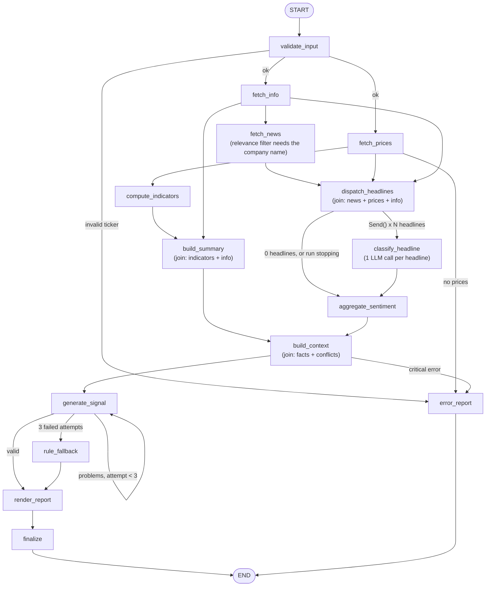

# Task 1: LLM-Powered Equity Research Assistant

[](https://colab.research.google.com/github/Gobishangar1/CDAZZDEV-MLE-GobishangarVijayendran/blob/main/task1_financial/notebooks/task1_equity_research.ipynb)

**Notebook (with executed outputs):** [`notebooks/task1_equity_research.ipynb`](notebooks/task1_equity_research.ipynb)
**Sample brief:** [`outputs/`](outputs/) (`brief.html`, `brief.md`, `chart.png`, `run.json`)

The pipeline fetches real market data for one ticker, computes five technical indicators from first
principles, classifies recent headlines with an LLM, and produces a validated Buy / Hold / Sell signal
plus a one-page research brief.

**Core design rule: Python does the maths, the LLM only judges.** Indicators, returns and the momentum
score are deterministic code. The LLM does two things only: label headline text, and weigh signals that
disagree.

## How to run

**Colab (recommended).** Open the badge above. Add `GROQ_API_KEY` in the Secrets panel (key icon) and
allow notebook access. Then run all cells. The first cell clones this repo and installs the requirements.

**Local**
```bash
cd task1_financial
pip install -r requirements.txt
export GROQ_API_KEY=...            # never commit it; .env is git-ignored
python -m pytest                   # 93 offline tests, a few seconds
python -m equity_research NVDA     # writes outputs/NVDA_<date>/ (brief, chart, run.json, trace.jsonl)
```
If Groq rejects JSON mode for a model, add `--no-json-mode`. The JSON parser still works without it.

## The workflow (LangGraph)



| LangGraph feature | Where | Why |
|---|---|---|
| Parallel branches | prices and info, then news | independent fetches run at the same time; news waits for the company name |
| `Send()` fan-out | `classify_headline` | one LLM call per headline; the count is only known at runtime; one bad reply loses one headline, not all |
| Reducers (`operator.add`) | `headline_results`, `errors`, ... | many branches write the same key in one step |
| Joins | `build_summary`, `dispatch_headlines`, `build_context` | wait for all inputs. `dispatch_headlines` stops the headline LLM calls when the price fetch failed in a parallel branch |
| Retry loop with feedback | `generate_signal → generate_signal` | the validator's problems go back into the next prompt |
| `node_guard` | every data node | an exception becomes an error record: no traceback, clean error report |

## Folder structure

```
task1_financial/
├── equity_research/
│   ├── config.py          every constant, with a reason; API key and logging setup
│   ├── schemas.py         Pydantic: HeadlineSentiment, TradeSignal, MarketSummary, ...
│   ├── prompts.py         ALL prompt text (system + human roles)
│   ├── market_data.py     yfinance OHLCV and company info, retries, data checks
│   ├── indicators.py      SMA, EMA, Wilder RSI, MACD, Bollinger (no TA-Lib)
│   ├── analysis.py        summary dictionary and rule-based momentum score
│   ├── news.py            provider chain + de-duplication
│   ├── llm.py             Groq clients (20B <-> 120B fallback), JSON helpers
│   ├── sentiment.py       per-headline LLM call, repair retry, aggregation
│   ├── signal_context.py  numbers -> facts and conflicts
│   ├── trade_signal.py    semantic validator and rule-based fallback
│   ├── report.py          chart, Markdown and HTML brief
│   ├── graph.py           the LangGraph workflow above
│   ├── tracing.py         trace.jsonl: every node and LLM call (model, latency, tokens, validation)
│   └── templates/brief.md.j2
├── notebooks/task1_equity_research.ipynb
├── outputs/               sample run (committed)
└── tests/                 one test file per module, all offline (fake Yahoo, fake LLM)
```

## Rubric map

| Criterion | Marks | Implementation | Evidence |
|---|---|---|---|
| OHLCV fetch | 10 | `market_data.fetch_prices`: start = today − `DateOffset(years=2)` − warm-up; `auto_adjust=True` | notebook §2, `test_market_data.py` |
| Indicator accuracy | 25 | `indicators.py`: Wilder seed for RSI, `adjust=False` EMA, `ddof=0` Bollinger | notebook §3 runs the tests; `test_indicators.py` uses hand-computed values |
| News retrieval | 10 | `news.py`: 3 free sources, both yfinance formats, dedupe, relevance filter | notebook §5, `test_news.py` |
| Summary dictionary | 10 | `analysis.build_summary` → `MarketSummary` | notebook §6, `test_analysis.py` |
| Robustness | 5 | `node_guard`, fail-soft info and news, data checks, `config.py` | notebook §12, `test_graph.py` |
| Per-headline JSON | 10 | `sentiment.py` + `HeadlineSentiment` (`headline`, `sentiment`, `confidence`, `brief_reason`) | notebook §8, `test_sentiment.py` |
| Signal reasoning | 15 | `signal_context.py` (facts + conflicts) + validator anti-echo / grounding checks | notebook §9-10, `test_trade_signal.py` |
| Structured validation | 10 | Pydantic + semantic validator; failures logged with raw text; repair / retry / fallback | notebook §11 fault injection |
| Prompt engineering | 5 | `prompts.py`: constants, `ChatPromptTemplate` system + human roles | notebook appendix |
| Bonus report | +5 | `report.py`: snapshot, chart, top 3 headlines, recommendation, disclaimer | notebook §13, `outputs/` |

## Key decisions (short)

- **Models.** The brief suggests Llama-3 on Groq. I use Groq's GPT-OSS models: 20B for headlines, 120B for
  the signal. Groq's free-tier limits are per model, so each model is the other's fallback, with one key
  and one provider. Model names are in `config.py`, so switching is a one-line change.
- **Warm-up buffer.** 300 extra calendar days, so SMA-200, the RSI seed and the EMA seeds have converged
  before the displayed 2-year window starts.
- **RSI uses Wilder's seed** (a simple mean of the first 14 changes), not `ewm(alpha=1/14)` alone. The two
  differ by up to about 10 RSI points at the start; the tests prove they converge later.
- **Bollinger uses the population std (`ddof=0`)**, which is Bollinger's definition. The pandas default
  (`ddof=1`) makes the bands √(20/19) wider; a test checks this.
- **Validation in two levels.** Pydantic checks the format. `validate_signal` checks the meaning: every
  number must come from the facts (1% tolerance), at least 2 indicators must be combined, conflicts must be
  addressed, confidence must be ≤ 0.75 when conflicts exist, and at least half of the sentences must link
  signals. The validator normalises Unicode dashes, because GPT-OSS writes "52‑week" with U+2011.
- **Anomalies are flagged, never removed.** In equities a large move is usually news, not noise.
- **News relevance.** My first real run showed that Yahoo's per-ticker RSS feed is mostly general market
  news (13 of 15 headlines were about Bitcoin, Palantir, ETFs...). Headlines must now name the ticker or the
  company; the chain continues to Google News until ten relevant ones are found, and general headlines are
  only used to fill the minimum, with a warning.

## Tracing

Every run writes `outputs/<TICKER>_<date>/trace.jsonl`: one JSON line per node (duration, ok/error) and
per LLM call (purpose, attempt, the model that actually answered, latency, input/output tokens, a
200-character output preview), plus every validation result. `run.json` contains a `trace_summary`
(wall time, LLM calls, API errors, failed validations, tokens, models used, time per node), and the CLI
prints it at the end of a run.

Optional, no code needed: LangChain and LangGraph also send full traces to LangSmith (free tier) when these
environment variables are set:
```bash
export LANGSMITH_TRACING=true
export LANGSMITH_API_KEY=...          # from smith.langchain.com; never commit it
export LANGSMITH_PROJECT=cdazzdev-task1
```
