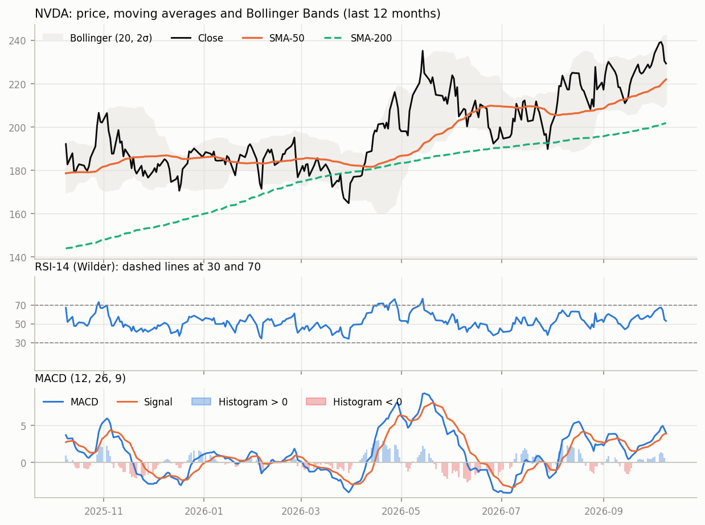

# NVIDIA Corporation (NVDA) - Equity Research Brief

**As of 2026-10-09** · Price **$229.28** · BUY · confidence 0.70 · source: LLM

## 1. Company snapshot

| Field | Value | Field | Value |
|---|---|---|---|
| Sector | Technology | Market cap | $5.54T |
| Current price | $229.28 | P/E (trailing) | 29.0 (trailingPE) |
| 52-week high | $243.37 | 52-week low | $163.90 |
| From 52-week high | -5.8% | YTD return | +23.2% |

## 2. Technical outlook

**Momentum signal: strong bullish** (score +0.62, from long trend +1.00, short trend +1.00, macd +0.50, rsi +0.15, bollinger +0.16)

- Close 229.28 is 3.3% above SMA-50 (221.94).
- Close is 13.6% above SMA-200 (201.83).
- SMA-50 is above SMA-200: long-term trend is up.
- Last moving-average cross: golden cross 323 trading days ago.
- MACD histogram is positive (+0.12) and shrinking toward zero (bullish momentum fading).
- MACD line is above its signal line and above zero.
- RSI-14 is 53.0 (neutral zone); it was 55.3 ten trading days ago.
- Bollinger %B is 0.58 (price inside the bands).
- Price is 5.8% below its 52-week high (243.37); 52-week low is 163.90.
- Year-to-date return is +23.2%.
- Trailing P/E is 29.0.
- News sentiment is +0.35 (positive) from 15 headlines; agreement 60%, coverage 100%.

**Conflicting signals**

- Trend is up, but MACD momentum is fading or negative.

## 3. News sentiment

**Positive (+0.35) from 15 headlines: 5 positive, 9 neutral, 1 negative · agreement 60% · coverage 100%**

| Headline | Publisher | Sentiment | Conf. | Reason |
|---|---|---|---|---|
| TSMC Reports Oct. 15. It's the Best Early Read on Nvidia's Next Quarter. | fool.com | positive | 0.90 | A favorable TSMC report suggests strong upcoming Nvidia earnings, likely boosting its share price. |
| NVIDIA Corporation $NVDA Shares Bought by Canada Pension Plan Investment Board - MarketBeat | MarketBeat | positive | 0.90 | Large institutional purchase signals confidence, likely boosting the stock. |
| Nvidia Weighs Buying Reflection AI, the $25 Billion Open-Weight Model Startup It Already Backs | tikr.com | positive | 0.90 | Acquisition of a high‑valued AI startup signals growth and expansion, likely boosting investor sentiment. |

## 4. Recommendation: BUY

The price is 3.3% above the SMA‑50 and 13.6% above the SMA‑200, confirming a strong uptrend while the SMA‑50 remains above the SMA‑200, which reinforces the bullish bias. The MACD line stays above its signal line and above zero, confirming bullish momentum despite the histogram shrinking toward zero, and the strong_bullish momentum score of +0.62 supports this view. News sentiment is +0.35 positive, adding further upside pressure while the YTD return of +23.2% shows recent strength. Although the MACD histogram is fading, the overall positive MACD line and momentum score outweigh this, so the fading signal does not overturn the bullish case.

**Key drivers:** price above SMA‑50 & SMA‑200 confirms uptrend; MACD line above zero & strong_bullish momentum score supports bullish bias

**Evidence against the call:** MACD histogram shrinking suggests fading momentum, but MACD line remains positive and momentum score is strong bullish, so it does not override the uptrend

## 5. Data quality notes

- News source yfinance returned no items

---

**Risk disclaimer.** This report is generated automatically for educational purposes only. It is not investment advice and must not be used to make investment decisions. Data may be delayed, incomplete or wrong, LLM output can be mistaken, and past performance does not predict future results.