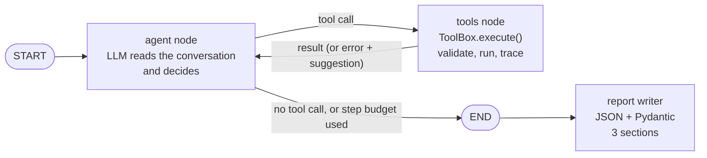
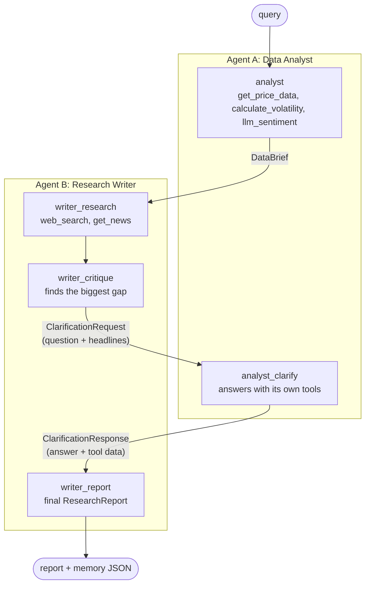

# Task 3: Multi-Agent Financial Research System

[](https://colab.research.google.com/github/Gobishangar1/CDAZZDEV-MLE-GobishangarVijayendran/blob/main/task3_agentic/notebooks/task3_agentic_research.ipynb)

**Notebook (with outputs):** [`notebooks/task3_agentic_research.ipynb`](notebooks/task3_agentic_research.ipynb) ·
**Trace log:** [`logs/agent_trace.jsonl`](logs/agent_trace.jsonl) · **Framework:** LangGraph ·
**LLM:** Groq `openai/gpt-oss-120b` (fallback `openai/gpt-oss-20b`) · **Ticker:** NVDA

The system answers the brief's query on its own:

> Analyse the current financial health and market sentiment of [TICKER]. Identify the top three risks to its
> share price over the next 90 days and suggest one data-driven hedge strategy.

- **3A:** one ReAct agent with five tools. The LLM chooses every tool and argument from what it has observed.
- **3B:** two agents with separate tools (Data Analyst, Research Writer), Pydantic handoffs, and one critique round.
- **3C:** session memory (checkpointer), a JSON brief cache by ticker and date, and a JSONL trace of every tool call.

## 3A: the agent loop



The code has **no tool order**. The graph only says "if the model asked for a tool, run it and go back to the
model". Python does the maths inside the tools; the LLM decides what to look at next and writes the report.

| Tool | What it returns (Pydantic model) |
|---|---|
| `get_price_data(ticker, period)` | `PriceData`: last close, period return, 52-week range, SMA-50/200, RSI-14, MACD, Bollinger, a trend sentence, last 5 OHLCV rows |
| `get_news(ticker, n)` | `NewsResult`: headlines (title, publisher, time, source, relevant) and warnings. Sources: yfinance, then Yahoo RSS, then Google News RSS |
| `calculate_volatility(ticker, window)` | `VolatilityResult`: annualised volatility = std(daily log returns, `ddof=1`) × √252, its percentile in the last year, 1-year max drawdown, 1-day 95% VaR |
| `llm_sentiment(headlines)` | `SentimentResult`: one LLM call for all headlines, validated per headline, confidence-weighted score in [-1, 1] |
| `web_search(query, max_results)` | `SearchResult`: DuckDuckGo results (title, URL, 220-character snippet) via `ddgs`, the new name of `duckduckgo-search` |

**Error handling.** Tools never raise into the agent. `ToolBox.execute()` turns bad arguments, network errors and
empty results into a result with `status` (`error` / `empty`) and a **suggestion** that names only tools this agent
has (for example "web_search failed: use get_news instead"). The prompt tells the agent to follow it. A malformed
tool call from the model is retried with a short correction, Groq errors fall back to the second model, and a step
budget forces a final answer, so a run always ends with a report. Notebook section 4 breaks `web_search` on purpose
and shows the agent switching tools.

## 3B: two agents and the critique loop



**Why they need each other.** Agent A can score sentiment but has no news access. Agent B has the news but no
sentiment, price or volatility tools. So the critique step usually asks A to score B's headlines (and often for a
volatility window closer to the 90-day horizon). The final report must fill `clarification_used`: how A's answer
changed or confirmed the report. Neither agent alone can produce that report.

**Restriction is enforced twice:** each agent's model is bound only to its own tool schemas, and `execute()` refuses
any other tool (`status: denied`, logged in the trace).

**Typed handoffs, no raw strings.** `DataBrief` (A → B), `ClarificationRequest` (B → A) and `ClarificationResponse`
(A → B) are Pydantic models in [`schemas.py`](research_agents/schemas.py). The numbers in the `DataBrief` are copied
from tool results by code, not retyped by the LLM, so they cannot drift. The pipeline is one LangGraph graph from
query to report: no manual step.

## 3C: memory and observability

| Requirement | How |
|---|---|
| Short-term memory | `ResearchSession` runs the agent with a LangGraph `InMemorySaver` and one `thread_id`. A follow-up question continues the same conversation, so the agent answers from earlier tool results. The notebook prints the number of tool calls for the follow-up (0). |
| Persistent memory | `run_research()` saves `memory/<TICKER>_<YYYY-MM-DD>.json` (report, data brief, the clarification pair, trace summary). The next run with the same ticker and date loads it and runs no agent and no tool. A broken file is ignored and the run starts again. |
| Observability | Every tool call is one line in `logs/agent_trace.jsonl`: `ts, run_id, agent, tool, inputs, output` (cut to 200 characters), `duration_ms` (wall clock), `status`, `error`. Agent messages (with the model's reasoning), handoffs, validation failures and cache hits are logged too. |
| Bonus dashboard | [`dashboard/app.py`](dashboard/app.py) (Streamlit) reads the trace: runs, totals, a timeline of tool calls per agent coloured by status, time per tool, the call table, agent messages and handoffs. |

## Rubric map

| Criterion | Code | Notebook |
|---|---|---|
| All five tools (correct types) | [`tools.py`](research_agents/tools.py), [`schemas.py`](research_agents/schemas.py) | 2 |
| Autonomous tool selection | [`agent.py`](research_agents/agent.py) (no fixed sequence), [`prompts.py`](research_agents/prompts.py) | 3, 3.1 |
| Observe and replan cycle | trace lines `thinks → calls → <- result → next decision` | 3, 4.2 |
| Final report quality | [`report.py`](research_agents/report.py): `ResearchReport` needs exactly 3 risks, each with evidence and sources | 3.2, 7.3 |
| Error handling | `ToolBox.execute()`, `ReActAgent._invoke_model()` | 4.1, 4.2 |
| Distinct roles, tool restriction | [`multi_agent.py`](research_agents/multi_agent.py) `TOOLS_A`, `TOOLS_B` | 6 |
| Structured handoff | `DataBrief`, `ClarificationRequest`, `ClarificationResponse` | 7.1 |
| Message trace visible | [`trace.py`](research_agents/trace.py) prints every message, call and handoff | 7 |
| Critique loop | `writer_critique` → `analyst_clarify` → `writer_report` | 7.2 |
| End-to-end automation | `run_research()` | 7 |
| Short-term memory | [`single_agent.py`](research_agents/single_agent.py) | 5 |
| Persistent cache | [`memory.py`](research_agents/memory.py), `run_research()` | 8 |
| `agent_trace.jsonl` | [`logs/agent_trace.jsonl`](logs/agent_trace.jsonl) | 9 |

## Run it

**Colab:** open the badge, add `GROQ_API_KEY` in the Secrets panel (key icon), then *Runtime → Run all*. The
last cell downloads `task3_outputs.zip` (trace, memory file, reports) so they can be committed.

**Locally:**

```bash
cd task3_agentic
pip install -r requirements.txt
python -m pytest                          # 55 offline tests: fake Yahoo, fake search, scripted models
export GROQ_API_KEY=...                   # or put it in a git-ignored .env file
python -m research_agents NVDA            # 3B pipeline (loads today's cache if it exists)
python -m research_agents NVDA --no-cache # force a fresh run
python -m research_agents NVDA --single   # 3A single agent + one follow-up question
pip install -r requirements-dashboard.txt
streamlit run dashboard/app.py            # trace dashboard
```

## Files

```
task3_agentic/
├── research_agents/
│   ├── config.py        constants (models, limits, windows) and key loading
│   ├── schemas.py       Pydantic: 5 tool results, 3 handoff messages, the report
│   ├── prompts.py       all prompts as constants
│   ├── market.py        yfinance download + indicators (adapted from Task 1)
│   ├── news.py          headline sources + relevance filter (adapted from Task 1)
│   ├── tools.py         the five tools + ToolBox.execute() (restriction, errors, trace)
│   ├── llm.py           Groq models with fallback; JSON + Pydantic + repair helper
│   ├── agent.py         reusable LangGraph ReAct agent (step budget, retries, checkpointer)
│   ├── single_agent.py  3A session + follow-up questions (short-term memory)
│   ├── multi_agent.py   3B pipeline graph + run_research() with the cache
│   ├── memory.py        JSON brief store keyed by ticker and date
│   ├── report.py        report writer and Markdown rendering
│   ├── trace.py         JSONL tracer + readable console trace
│   └── trace_view.py    trace file -> tables (notebook and dashboard)
├── dashboard/app.py     Streamlit trace viewer (bonus)
├── notebooks/           the Colab notebook, with outputs
├── tests/               offline pytest suite
├── logs/                agent_trace.jsonl
├── memory/              cached briefs (<TICKER>_<date>.json)
└── outputs/             the 3A and 3B reports as Markdown
```

## Design choices and limits

- **LangGraph over CrewAI:** the loop, the step budget, the handoffs and the critique round are explicit graph
  edges, so they are easy to test and to show in a trace.
- **Groq GPT-OSS, not Llama-3:** the brief suggests Llama-3 on Groq, but GPT-OSS-120B is the strongest free tool-calling
  model there now. The free tier allows about 8K tokens per minute per model, so tool outputs sent to the LLM are
  capped (2,500 characters, 5 OHLCV rows, 220-character snippets) and the two models share the load as each other's
  fallback. A full notebook run takes several minutes because of these limits.
- **Free data is noisy:** DuckDuckGo can rate-limit and free news feeds miss articles. Both are handled as tool
  failures that the agent must work around.
- **The cache key is ticker + date**, as the brief says. A run on a later day does not reuse an older brief.
- **Not investment advice.** Volatility, drawdown and VaR are historical; the hedge is an illustration.
